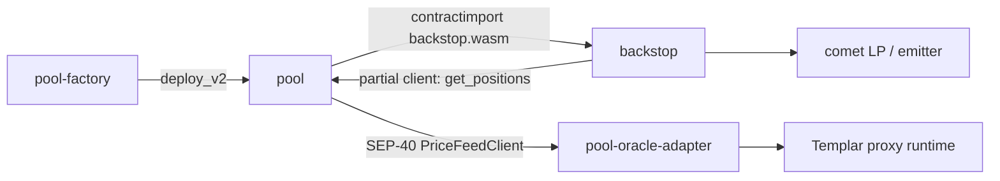

# Repository Guidelines

## Project Overview

Precept is Templar's audited fork of Blend v2, a lending protocol on Soroban (Stellar). The pool mechanics are stock Blend (b-tokens/d-tokens, utilisation-curve interest, user liquidation auctions). What changed is who takes a loss: the backstop is disabled, so bad debt is socialised pro rata to the lenders of the affected reserve. `v0.1.0` is the Guardian-reviewed release (`audits/`). Deployed addresses live in `registry/*.jsonl`. No contract has an upgrade entrypoint.

## Architecture & Data Flow



- **Build order matters.** `pool` imports the *built* backstop wasm (`pool/src/dependencies/backstop.rs`, reads `target/wasm32v1-none/release/backstop.wasm`). `backstop` does the same for the factory. Run `just build` before `cargo test`, Kani, or IDE checks of `pool`.
- **Entrypoint pattern** (`*/src/contract.rs`): `storage::extend_instance(&e)` → `admin.require_auth()` (or the user) → delegate to a module → emit an event. `submit` authorises `spender`, plus `from` only when it differs.
- **The fork in code** (full table: `docs/changes-from-blend-v2.md`):
  - Disabled with `panic_with_error!(BadRequest)`: pool `update_pool`, `flash_loan`, `set_emissions_config`; backstop `distribute`, `gulp_emissions`, `add_reward`, `remove_reward`, `claim`, `drop`. Bad-debt and interest auctions (request types 7/8) are unreachable.
  - `bstop_rate != 0` is rejected at init and at factory deploy. `gulp` returns 0.
  - Bad debt (`pool/src/pool/bad_debt.rs`, `user.rs::default_liabilities`): set off the user's own supply first. Only if debt remains is it defaulted (lowering `b_rate`), and only then is the user's residual collateral orphaned under the pool address; if the setoff clears the debt, the user keeps the collateral.
  - Status 4 (frozen) is permanent, and `set_status(4)` returns before any other check. Leaving setup (status 6) for 0/2/3 requires a 7-decimal oracle. After activation, reserve changes can only disable. `set_status(0)` requires the backstop threshold, $\lfloor blnd\rfloor^4 \lfloor usdc\rfloor \ge 10^{25}$, and `q4w_pct < 50%` (`pool/src/pool/status.rs`).
  - Prices are rejected if missing, in the future, older than 24 h, or ≤ 0 (`pool/src/pool/pool.rs`).
- **Storage tiers** (`pool/src/storage.rs`): instance = admin, config, name, backstop, BLND; persistent = positions and reserve data; temporary = proposed admin, queued reserve init, auctions. TTLs derive from `ONE_DAY_LEDGERS = 17280`. The proposed admin is stored as `(address, expiry_ledger = now + 10d)` and the getter re-checks that bound, so extending the TTL does not extend the deadline.
- **Reserve cache**: `load_reserve` / `cache_reserve` / `store_cached_reserves` must be paired with `user_state.store` (`pool/src/pool/pool.rs`).

## Key Directories

| Path | Purpose |
| --- | --- |
| `pool/src/` | Pool contract: `contract.rs` (trait + impl), `pool/` (submit, actions, reserve, user, status, bad_debt, gulp, …), `auctions/`, `math.rs`, `events.rs`, `spec/` (Certora), `proofs/` (Kani) |
| `backstop/`, `pool-factory/` | Backstop (emissions/insurance disabled) and factory (deterministic pool address from `keccak256(salt ‖ admin)`) |
| `pool-oracle-adapter/` | Immutable SEP-40 view over a proxy oracle. **Separate gate** (`just audit-ready`), 32 KiB size cap |
| `shared/` | Source files included into pool and backstop via `#[path = "../../shared/…"] mod …;` |
| `mocks/` | Mock pool, factory and ERC-3156 contracts for tests |
| `test-suites/` | Integration tests (`tests/`), fixture (`src/`), fuzzing (`fuzz/`, its own workspace) |
| `verification/` | Kani harness lists and expected covers, Verus, Certora receipts. See `VERIFICATION.md` |
| `registry/` | Deployment records (`mainnet.jsonl`, `testnet.jsonl`), pool configs (`configs/*.json`), `registry.py` |
| `tools/abtest/` | `precept-abtest` differential and deployer CLI. Own workspace and `AGENTS.md` |
| `scripts/` | Python CI helpers: pool deploy CI, docs check, Kani/Verus runners |
| `sign/` | Static co-signer web page (Bun tests, vendored deps + `SHA256SUMS`) |
| `docs/` | In-depth repo docs (GitBook), including `emergency-runbooks/` |
| `docs-library/` | Public docs site, submodule of `Templar-Protocol/precept-docs` (added in PR #68) |

## Development Commands

Enter the dev shell first: `devenv shell` (or direnv `use devenv`). It pins Rust 1.98.0 and builds Stellar CLI 28.1.0, exported as `PRECEPT_STELLAR_BIN`.

```bash
just                      # build factory → backstop → pool wasm + stellar contract optimize
just test                 # just build, then cargo test --all --tests
cargo test -p test-suites --test <file>   # one integration file (after just build)
just fmt                  # CI runs cargo fmt --all --check
just differential         # stock-vs-fork ADR-8 differential (pinned base 6cf6dd1, built with its own Makefile)
just verify-local         # Python gates + Kani/Verus acceptance set under resource containment
just fuzz-test fuzz-replay fuzz-lint fuzz-build
(cd pool-oracle-adapter && just audit-ready)   # adapter gate: fmt, clippy, tests, build, spec and size checks
(cd tools/abtest && just check)                # abtest tests + clippy -D warnings
python3 registry/registry.py check         # registry schema and canonical order (offline)
python3 scripts/check_docs.py              # docs/ SUMMARY and link gate
(cd sign && bun test)
```

Kani: run `just build` first, unset `RUSTC_WRAPPER` (sccache breaks kani-compiler), and always pass `--exact`:
`cargo kani -p pool --lib --exact --harness <path::name> --solver kissat -Z unstable-options --harness-timeout 600s`.

## Code Conventions & Common Patterns

- **Errors**: `#[contracterror]` enums with `panic_with_error!`. Shared low codes (1, 3, 4, 8, 10, 12); backstop 1000–1011; pool 1200–1224 (e.g. `StatusNotAllowed = 1204`); factory 1300. Keep existing codes stable.
- **Numerics**: 7-decimal fixed point (`SCALAR_7`, plus `SCALAR_12`, and `SCALAR_14` in backstop) through the `FixedMath` / `SorobanFixedPoint` traits (`pool/src/math.rs`). Rounding direction is always explicit (`to_b_token_up/down`, `to_d_token_up/down`). Percent literals are written `0_5000000` (= 50%).
- **Release profile** has `overflow-checks = true` (`Cargo.toml`). Never remove it.
- **Events**: `events().publish` stays (`#![allow(deprecated)]`), because the topics are the audited surface. Fork-only topics: `debt_setoff`, `collateral_orphaned`, `orphan_settled`.
- **cfg layering**: `#[cfg(feature = "certora")]` for `spec/` summaries; `#[cfg(kani)] #[path = "../proofs/<f>.rs"] mod verification;` for proofs. Do not rename harnesses: CI selects them by exact path.
- **Registry**: edit only through `registry.py add` (`--update` to replace). It rewrites the file canonically (sorted keys, compact JSON, fixed line order). Configs are pre-deploy inputs; `null` means undecided.
- Justfiles set `dotenv-load := false`. Never rely on `.env`.

## Important Files

- `pool/src/contract.rs`: the pool's public API. `pool/src/pool/status.rs`: status machine. `pool/src/storage.rs`: keys and TTLs.
- `Cargo.toml` (workspace, release profile), `rust-toolchain.toml` (1.98.0, `wasm32v1-none`), `justfile` (all build, test and verification recipes; there is no Makefile), `devenv.nix`.
- `.github/workflows/pull_request.yml`: required gates. `release.yml`: reproducible wasm + `SHA256SUMS`. `pool-plan.yml` / `pool-deploy.yml`: digest-approved deploys.
- `registry/README.md`: registry schema and pool deploy flow. `scripts/pool_deploy_ci.py`: plan/deploy orchestration.
- `VERIFICATION.md`, `docs/verification/`: formal verification. `docs/changes-from-blend-v2.md`: fork delta.
- `.github/CODEOWNERS`: registry configs, `registry.py`, `tools/abtest/`, the deploy scripts and the deploy workflows need Templar review.

## Runtime/Tooling Preferences

- Rust 1.98.0 with the `wasm32v1-none` target; Stellar CLI exactly 28.1.0 (CI and the adapter gate check the version). Kani 0.68.0. Fuzzing uses `nightly-2026-08-21` and cargo-fuzz 0.13.2.
- Python is stdlib only (`unittest`, `urllib`); no pytest, no extra dependencies. Run suites with strict diagnostics: `PYTHONDEVMODE=1 python3 -W error -m unittest discover -s registry`.
- `sign/` uses Bun. `docs-library/` uses npm + HonKit.
- Do not touch `comet.wasm` (AGPL, test-only), pinned toolchain versions, the Kani harness and cover files, or the adapter's artifact SHA pin.
- `tools/abtest`: don't regenerate `Cargo.lock` casually, and the crate is not rustfmt-clean, so format only the files you touch. See `tools/abtest/AGENTS.md`.

## Testing & QA

- **Rust**: soroban-sdk testutils. Unit tests sit in `#[cfg(test)] mod tests` at the bottom of each module. Integration tests use `TestFixture::create(wasm: bool)` / `create_fixture_with_data` (`test-suites/src/`): fixed ledger, `mock_all_auths`, tokens indexed by the `TokenIndex` enum, helpers `jump()`, `create_pool_reserve`, `assert_approx_eq_abs`. Assert auth via `env.auths()`.
- `test_snapshots/` is gitignored. Don't commit generated snapshots. The only committed snapshot is `test-suites/src/mainnet-55261759-snapshot.json`.
- **Fuzz**: committed regression seeds go in `test-suites/fuzz/regression-seeds/` as JSON and replay with `just fuzz-replay`.
- **Formal**: the PR set is `verification/kani-ci-harnesses.txt`, checked by `scripts/check_kani_ci.py`. The cover counts in `verification/kani-expected-covers.json` must match exactly, including zero. The full set runs weekly. Verus runs with `--no-cheating` and needs a negative-control mutation.
- **Required PR gates**: `fmt`, `build-and-test`, `kani-codegen`, `kani-proofs`, `local-verification`. Registry, docs, adapter and abtest workflows trigger on their own paths.
- **Mainnet safety**: the only CI path that sends transactions is `pool-deploy.yml`, running a plan whose digest was approved by merging the PR. CI never calls `set_status`; activation is the curator's call. The curator must call `accept_admin` within 10 days of `propose_admin`, or the proposal lapses.

## Documentation

There are two documentation sets, and a change that affects users can need both.

| Set | Path | Audience |
| --- | --- | --- |
| Repo docs | `docs/` (GitBook, gated by `scripts/check_docs.py`; the import uses `force: true`, so edit only by PR) | Auditors, integrators, maintainers: mechanism, code permalinks, admin levers, runbooks |
| Public docs | `docs-library/` → `Templar-Protocol/precept-docs` (private repo; HonKit on Vercel, published at https://docs.precept.templarfi.org/) | Lenders, borrowers, market creators, developers |

**Public docs policy.** The site is public; its source repo is private. Change it only by a pull request on `Templar-Protocol/precept-docs`. Never edit, commit or push inside `docs-library/` from this repo, and never change the site any other way: merging to precept-docs `main` publishes to https://docs.precept.templarfi.org/.

- A change to contract behaviour, parameters, admin or governance levers, risks or the release process updates `docs/` in the same PR. If the change is visible to users, also open a PR on precept-docs and link the two PRs. After the precept-docs PR merges, bump the `docs-library` pointer here (`git submodule update --init docs-library`, check out the merged commit) so the pair records which docs match which code.
- Ground every claim in code at a cited commit or in live pool state. Keep one source per fact: public pages link to `docs/` for depth instead of copying it.
- Public pages follow `docs-library/CONTRIBUTING.md`: say "market", not "pool"; no em dashes; pinned code links only on `developers/code-references.md`; name Blend only on `developers/code-lineage.md`. Run `npm run check && npm run build` there.
